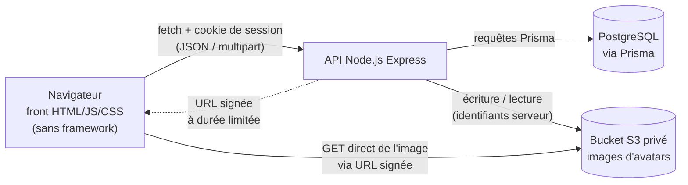
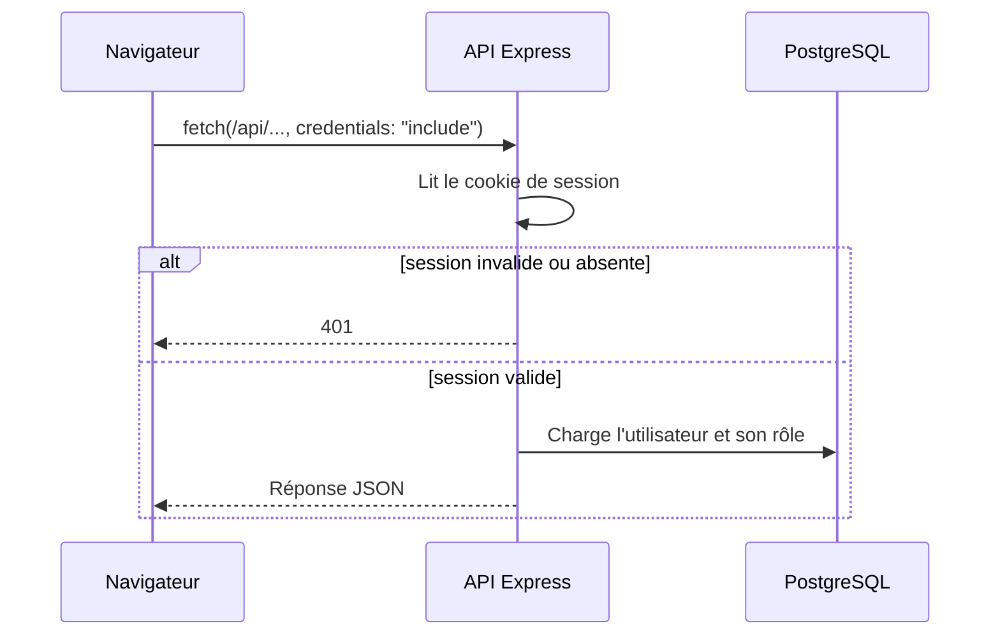
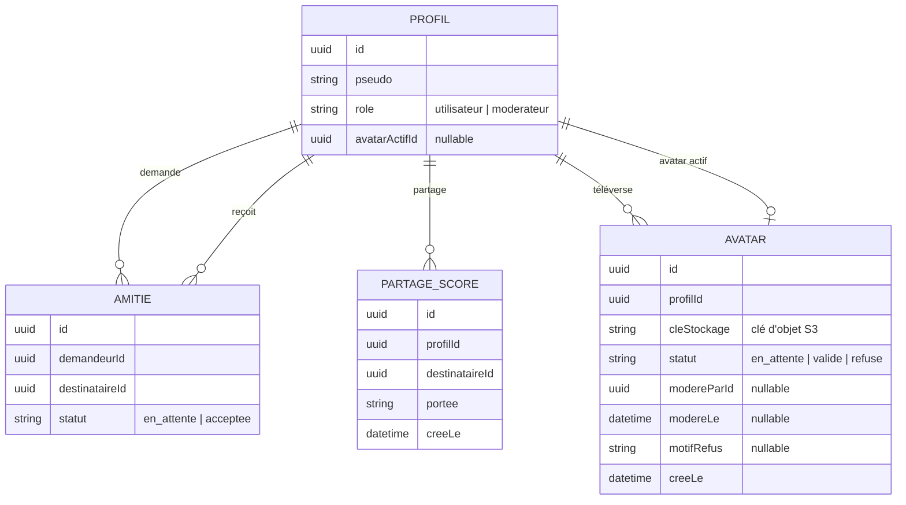
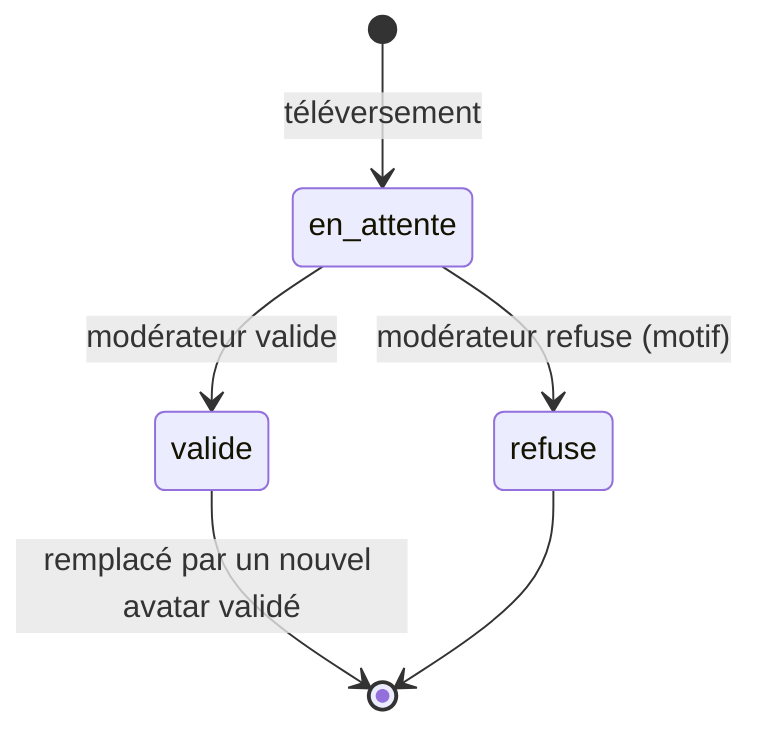
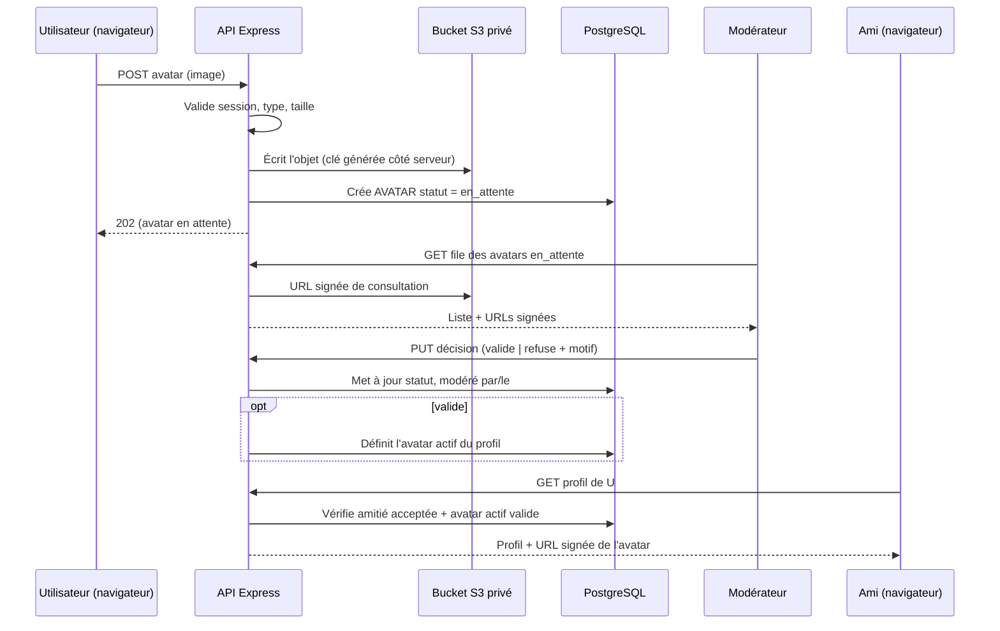
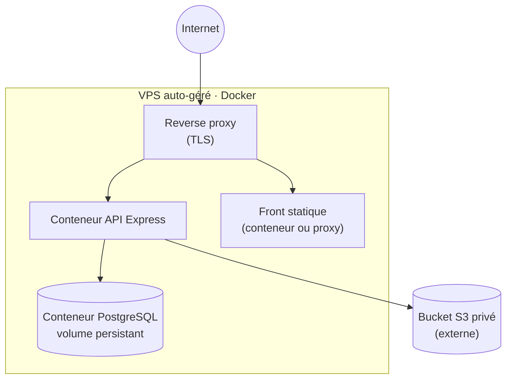

# Architecture cible et flux de modération des avatars

Ce document décrit l'architecture cible de l'application : le front web existant, la nouvelle API, la base de données, le stockage d'images et le déploiement. Il détaille aussi le cycle de vie d'un avatar téléversé et les règles de visibilité qui en découlent. Il décrit le fonctionnement attendu, pas une procédure de mise en œuvre.

> **Verify** : aucune version d'outil n'est fixée ici. Les versions de Node.js, Express, Prisma, PostgreSQL et Docker sont celles des manifestes et fichiers de verrouillage du projet (`package.json`, lockfile, `Dockerfile`, fichier Compose). L'auteur confirme ces points avant fusion.

## 1. Composants et responsabilités

| Composant | Responsabilités | Ce qu'il ne fait pas |
|---|---|---|
| **Front web** (existant) | Affichage, saisie, appels `fetch` vers l'API, affichage des avatars via les URLs signées reçues | Aucune règle de visibilité ni de modération ; ne connaît ni les clés S3 ni la base |
| **API Express** (nouvelle) | Vérifier la session, appliquer les règles métier (amitié, partage, visibilité, modération), persister, émettre les URLs signées | Ne sert pas les fichiers statiques du front (sauf choix contraire du déploiement) |
| **PostgreSQL + Prisma** | Source de vérité des profils, amitiés, partages de score et statuts d'avatar | Ne stocke pas les octets des images |
| **Bucket S3 privé** | Stockage des images ; aucun accès public | Ne décide jamais de qui peut voir une image |

**Invariants**
- Seule l'API accède à la base et au bucket avec des identifiants ; le navigateur n'a jamais de clé de stockage.
- Toute décision d'autorisation est prise côté API, jamais côté front.

## 2. Authentification par cookie de session et appels fetch

L'authentification existante par cookie de session est conservée. L'API s'appuie dessus pour identifier l'utilisateur courant et ne crée pas de second mécanisme.

Règles :
- Chaque appel `fetch` vers l'API inclut les cookies (`credentials`). Si le front et l'API sont sur des origines différentes, la configuration CORS autorise explicitement l'origine du front avec les identifiants.
- L'identité de l'utilisateur vient **uniquement** de la session, jamais d'un paramètre du corps ou de l'URL (pas d'`utilisateurId` fourni par le client pour les actions « sur soi »).
- Le cookie est `HttpOnly`, `Secure` et avec un attribut `SameSite` adapté. Comme l'authentification repose sur un cookie, les routes qui modifient l'état exigent une protection contre le CSRF.
- Le rôle (utilisateur ou modérateur) est lu côté serveur à chaque requête sensible.

> **Verify** : confirmer le mécanisme réel de session existant (stockage, durée, nom du cookie) et si front et API partagent la même origine ; adapter CORS, `SameSite` et CSRF en conséquence.

## 3. Modèle de données

Points structurants :
- **Profil** : un par utilisateur ; référence au plus un avatar actif, qui doit avoir le statut `valide`.
- **Amitié** : relation entre deux profils avec un statut ; seule une amitié `acceptee` ouvre des droits de visibilité. Une seule relation existe par paire de profils.
- **Partage de score** : enregistre qu'un profil partage son score avec un autre ; il est indépendant de la modération des avatars.
- **Avatar** : l'enregistrement porte le statut de validation et la clé d'objet dans le bucket (jamais une URL publique). Un profil peut avoir plusieurs avatars au fil du temps (historique, refus).

Les noms de champs sont indicatifs ; le schéma Prisma versionné dans le dépôt fait foi.

## 4. Cycle de vie d'un avatar et règles de visibilité

### Règles de visibilité

| Qui regarde | Avatar `en_attente` | Avatar `valide` | Avatar `refuse` |
|---|---|---|---|
| Propriétaire | Oui (aperçu, marqué « en attente ») | Oui | Oui, avec le motif de refus |
| Ami (amitié `acceptee`) | Non | Oui | Non |
| Autre utilisateur | Non | Selon la règle de visibilité du profil (à confirmer) | Non |
| Modérateur | Oui (file de modération) | Oui | Oui |

Pour tout spectateur sans droit sur l'avatar, l'API renvoie l'avatar par défaut du front (pas d'indication qu'une image est en attente ou refusée).

**Invariants**
- Une image non `valide` n'est jamais exposée à un autre utilisateur que son propriétaire ou un modérateur.
- Seule l'API émet des URLs signées, et seulement après contrôle des droits. Leur durée de vie est courte et configurable.
- Le profil ne pointe vers un avatar actif que si celui-ci est `valide` ; un nouveau téléversement `en_attente` ne remplace pas l'avatar actif tant qu'il n'est pas validé.
- Les transitions de statut sont réservées au rôle modérateur ; `valide` et `refuse` sont finaux pour un enregistrement donné.
- Le serveur génère la clé d'objet ; le nom de fichier client n'est jamais utilisé comme clé.
- Le serveur contrôle le type réel et la taille du fichier, pas seulement l'extension ni le `Content-Type` déclaré.

> **Verify** : confirmer avec le produit la visibilité d'un avatar validé pour un non-ami, et si un refus doit notifier l'utilisateur.

## 5. Déploiement Docker sur VPS

Règles :
- Chaque composant tourne dans son propre conteneur ; l'orchestration est décrite dans un fichier Compose versionné.
- Seul le reverse proxy expose des ports publics, avec terminaison TLS. PostgreSQL n'est joignable que sur le réseau interne Docker.
- Les données PostgreSQL vivent dans un volume persistant, avec sauvegardes planifiées et restauration testée. Les images, elles, sont dans le bucket.
- Les secrets (identifiants de base, clés S3, secret de session) sont injectés par l'environnement ou des secrets Docker, jamais committés ni inclus dans l'image.
- Les migrations Prisma sont appliquées de façon contrôlée au déploiement, avant le démarrage de la nouvelle version de l'API.
- Le VPS étant auto-géré, la mise à jour de l'OS, le pare-feu, la rotation des journaux et la surveillance relèvent de l'équipe.

> **Verify** : confirmer le fournisseur S3 (ou compatible), le choix du reverse proxy et la stratégie de sauvegarde ; ces points ne sont pas tranchés ici.

## Hors périmètre

- Choix détaillés de bibliothèques (upload, traitement d'image, session) : à décider dans des ADR dédiés.
- Modération automatique (détection de contenu) : non prévue dans cette architecture cible.